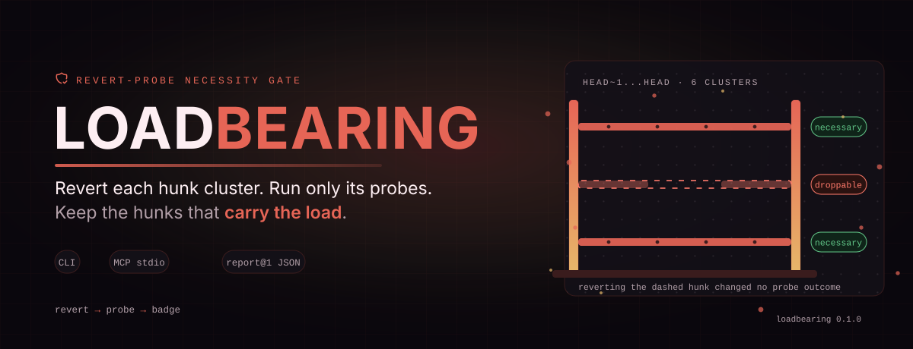
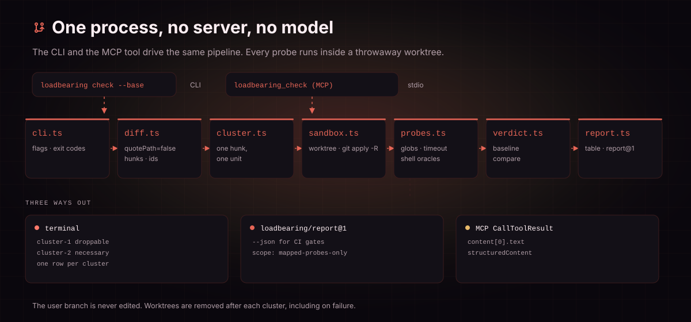
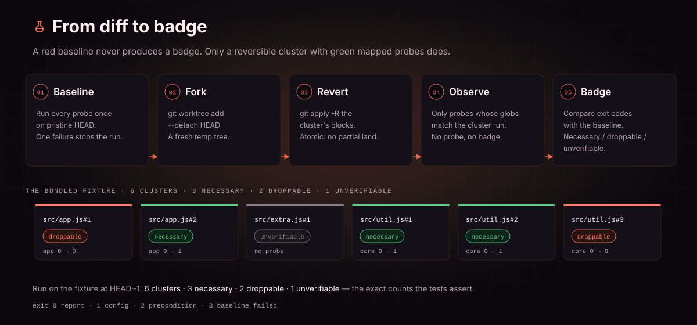
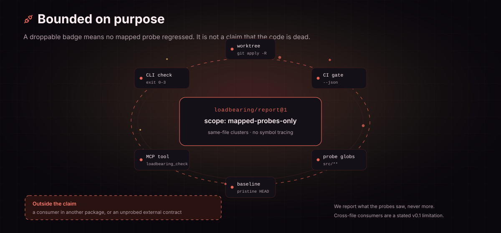

**English** | [简体中文](./README.zh-CN.md)

<p align="center">
  <picture>
    <source media="(max-width: 700px) and (prefers-color-scheme: dark)" srcset="./assets/hero-narrow-dark.svg">
    <source media="(max-width: 700px) and (prefers-color-scheme: light)" srcset="./assets/hero-narrow-light.svg">
    <source media="(prefers-color-scheme: dark)" srcset="./assets/hero-dark.svg">
    <source media="(prefers-color-scheme: light)" srcset="./assets/hero-light.svg">
    
  </picture>
</p>

<p align="center">
  <a href="https://github.com/SuperMarioYL/loadbearing/actions/workflows/ci.yml"></a>
  
  
  
  
</p>

<p align="center"><strong>Revert the hunk. Run the probes. Keep what is loadbearing.</strong></p>

Loadbearing is a free, open-source necessity gate for agent-authored pull
requests. It reverts each hunk cluster in a throwaway `git worktree`, runs only
the probes whose globs cover that cluster's files, and badges the clusters whose
removal changed no probe outcome. The reviewer stops auditing every line and
starts clearing verdicts: bounce the droppable clusters, read the rest.

```console
$ loadbearing check --base HEAD~1
...
6 clusters: 3 necessary, 2 droppable, 1 unverifiable
```

No model, no server, no branch edits. One Node process and your existing probes.

## The question is necessity, not correctness

A coding agent opens a pull request with six hunks across three files. You can
review correctness line by line, approve most of it, and still not know which
lines were needed. The expensive question is different: **what happens if this
hunk disappears?** For most hunks, nobody runs the experiment.

The current countermeasures sit on either side of that question. Prompt-level
minimality skills bias the agent *before* it writes, but a bias is not a proof.
Patch coverage tells you a changed line executed; a redundant hunk touched by a
test is 100% covered and still unnecessary. An LLM diff critic gives you an
opinion you cannot verify without doing the work the critic was meant to save.
Mutation testing perturbs code and observes probes, but it scores test-suite
adequacy against generated mutants, not the diff in front of you.

Loadbearing asks the counterfactual directly and answers it with execution
evidence: remove the cluster, rerun its probes, compare exit codes.

## See it work

The bundled fixture is a deliberately agent-shaped PR: three files, six hunks,
two probes that observe only some of those files. Install the packed CLI (see
[Installation](#installation)), then run it against the fixture:

```console
$ loadbearing check --base HEAD~1
base HEAD~1  head 1c87c62  6 clusters
scope mapped-probes-only: a verdict covers only the probes mapped to that cluster's files
baseline green (2 probes on HEAD)

cluster-1  droppable     probes-unaffected  src/app.js#1
    app   node test/app.js
      baseline 0 -> reverted 0
cluster-2  necessary     probe-failed       src/app.js#2
    app exited 1 while reverted
    app   node test/app.js
      baseline 0 -> reverted 1
cluster-3  unverifiable  no-probe           src/extra.js#1
    no probe matches src/extra.js
cluster-4  necessary     probe-failed       src/util.js#1
    core exited 1 while reverted
    core  node test/core.js
      baseline 0 -> reverted 1
cluster-5  necessary     probe-failed       src/util.js#2
    core exited 1 while reverted
    core  node test/core.js
      baseline 0 -> reverted 1
cluster-6  droppable     probes-unaffected  src/util.js#3
    core  node test/core.js
      baseline 0 -> reverted 0

6 clusters: 3 necessary, 2 droppable, 1 unverifiable
```

The report as JSON ends with:

```json
"summary": { "total": 6, "necessary": 3, "droppable": 2, "unverifiable": 1 }
```

The two `droppable` rows are the point. `src/app.js#1` adds `Number()` around an
integer sum and `src/util.js#3` adds a helper no mapped probe touches; reverting either
changes no probe outcome. `src/app.js#2` pins rounding, so the probe fails without it. The third
file maps to no probe, so it gets no badge instead of a guess.

- Recorded terminal session: [`docs/assets/demo.cast`](./docs/assets/demo.cast)
  (asciinema v2, 15 seconds). Play it with
  `asciinema play docs/assets/demo.cast`.
- Exact commands, captured stdout, and the full report:
  [`docs/demo-results.json`](./docs/demo-results.json).
- Recording script: [`docs/record-demo.sh`](./docs/record-demo.sh).
- The recording and the block above both run the packed 0.1.0 tarball against
  the seeded fixture; `docs/demo-results.json` stores the exact stdout. The only
  value that changes when you reseed the fixture is the short `head` SHA.

## How a verdict is made

<p align="center">
  <picture>
    <source media="(prefers-color-scheme: dark)" srcset="./assets/architecture-dark.svg">
    <source media="(prefers-color-scheme: light)" srcset="./assets/architecture-light.svg">
    
  </picture>
</p>

The rules are ordered, and the order matters:

1. **Baseline first.** Every configured probe runs once on pristine `HEAD`. If
   any fails, the run exits 3 and mapped clusters become
   `unverifiable:baseline-failed`. A red baseline never yields a badge.
2. **One cluster at a time.** Each hunk starts as its own cluster. A fresh
   detached worktree is created for it; only that cluster's verbatim hunk blocks
   are reverse-applied with `git apply -R`.
3. **Merge on apply failure.** If the reverse apply fails, the next hunk in the
   same file joins the cluster and the apply is retried. If the file still
   fails, the cluster is `unverifiable:revert-apply-failed`.
4. **Only mapped probes run.** A probe maps to a cluster when any of its globs
   matches any of the cluster's files. A probe that passed at baseline and fails
   when reverted makes the cluster `necessary`. If every mapped probe passes,
   the cluster is `droppable`.
5. **No oracle, no badge.** No matching probe is `unverifiable:no-probe`; a
   timeout, signal, spawn failure, or failed `sandbox.setup` is
   `unverifiable:probe-error`.

<p align="center">
  <picture>
    <source media="(prefers-color-scheme: dark)" srcset="./assets/process-dark.svg">
    <source media="(prefers-color-scheme: light)" srcset="./assets/process-light.svg">
    
  </picture>
</p>

The cost is one baseline suite run plus one run per judged cluster. Execution is
sequential; `--timeout` caps each probe and `--max-clusters` marks the remainder
`unverifiable:skipped`. The user's branch is never edited, and every worktree is
removed, including after a failure.

## Installation

Requirements: Node 20 or newer, `git`, and macOS or Linux. Tested on Node 22.

The 0.1.0 artifact ships as a GitHub Release tarball
(`loadbearing-gate-0.1.0.tgz`). Install it directly, or build from source:

```console
# from the release tarball
curl -LO https://github.com/SuperMarioYL/loadbearing/releases/download/v0.1.0/loadbearing-gate-0.1.0.tgz
npm install -g ./loadbearing-gate-0.1.0.tgz
loadbearing --version

# or clone, build, and link the binary
git clone https://github.com/SuperMarioYL/loadbearing.git
cd loadbearing
npm ci
npm run build
npm link
loadbearing --version
```

The package name is `loadbearing-gate`; the binary is `loadbearing`. The short
package name belongs to an unrelated project, so the package name is scoped to
avoid running the wrong tool. The package is not on the npm registry yet: once
published, `npm install -g loadbearing-gate@0.1.0` will work (see the roadmap).

## Quickstart

### Try the bundled fixture (no config needed)

These commands run from a clone and use the exact tarball the release workflow
publishes:

```console
git clone https://github.com/SuperMarioYL/loadbearing.git
cd loadbearing
npm ci
npm run build
npm pack
bash fixtures/seed-agent-pr.sh /tmp/lb-demo
cd /tmp/lb-demo
npx --yes "file:$OLDPWD/loadbearing-gate-0.1.0.tgz" check --base HEAD~1
```

You should see `6 clusters: 3 necessary, 2 droppable, 1 unverifiable`. The
fixture's own `loadbearing.yml` maps `test/core.js` to `src/util.js` and
`test/app.js` to `src/app.js`; nothing maps to `src/extra.js`.

### Add the gate to your repository

Your project needs a `package.json` with at least one of the `test`, `typecheck`,
or `lint` scripts, and a branch to compare against.

```console
cd your-project
loadbearing init
```

`init` writes `loadbearing.yml` with one probe per script it found and broad
default globs (`src/**`, `lib/**`, `test/**`, `tests/**`), applied to every
probe. This is the exact file `init` writes for a `package.json` with `test`,
`typecheck`, and `lint` scripts:

```yaml
# Loadbearing probes: each command is an oracle for the file globs below.
# A cluster is droppable only when every probe mapped to its files still passes.
schema: loadbearing/config@1
probes:
  - name: test
    run: npm test
    paths:
      - src/**
      - lib/**
      - test/**
      - tests/**
  - name: typecheck
    run: npm run typecheck
    paths:
      - src/**
      - lib/**
      - test/**
      - tests/**
  - name: lint
    run: npm run lint
    paths:
      - src/**
      - lib/**
      - test/**
      - tests/**

# Run once per sandbox worktree before probes (uncomment when you have a lockfile):
# sandbox:
#   setup: npm ci
```

Tighten `paths` until each probe covers the files whose breakage it can actually
observe. Then run the gate against the branch point:

```console
loadbearing check --base origin/main
```

Commit or stash local changes first: `check` exits 2 on a dirty tree, because a
verdict only means something when `HEAD` is what gets reverted.

## Usage

```
loadbearing init
loadbearing diff  --base <rev> [--json]
loadbearing check --base <rev> [--json] [--config <path>] [--timeout <seconds>]
                  [--max-clusters <n>] [--keep-worktrees]
loadbearing mcp
loadbearing --version
```

| Command | What it does |
| --- | --- |
| `init` | Writes a starter `loadbearing.yml` from `package.json` scripts. Refuses to overwrite an existing file. |
| `diff` | Lists `file#n` hunk ids and one-hunk clusters for `<base>...HEAD`. `--json` emits `{base, files, clusters}`; sections that cannot be judged carry an `unsupported` marker. This is an inventory, not a verdict report. |
| `check` | Runs the baseline, reverts each cluster, runs mapped probes, prints the verdict table or the `loadbearing/report@1` JSON. |
| `mcp` | Serves `loadbearing_check` over MCP stdio. Stdout carries protocol frames only. |

`check` exit codes:

| Code | Meaning |
| --- | --- |
| `0` | A report was emitted. Verdicts may still be unverifiable. |
| `1` | Config or flag error. |
| `2` | Precondition failure: unknown base, no shared history, not a git repo, or a dirty tree. |
| `3` | Baseline failed. The report is still emitted. |

Use `--keep-worktrees` when a reverse apply fails and you want to inspect the
sandbox. The kept paths are printed to stderr.

## Use it from a coding agent

`loadbearing mcp` exposes one tool, `loadbearing_check`, with the input
`{base, config?, timeout?}`. It returns a `CallToolResult`: the report JSON in
`content[0].text` and the same object in `structuredContent`. A bad base returns
`isError: true` instead of crashing the server.

Claude Code (requires the CLI installed, see [Installation](#installation)):

```console
claude mcp add loadbearing -- loadbearing mcp
```

Cursor (`~/.cursor/mcp.json` or `.cursor/mcp.json`):

```json
{
  "mcpServers": {
    "loadbearing": {
      "command": "loadbearing",
      "args": ["mcp"]
    }
  }
}
```

Ask the agent to call `loadbearing_check` with `{"base": "origin/main"}` before
it requests review. The agent gets the same verdicts a human sees; it can drop
the droppable hunks itself or leave them for the reviewer.

## Configuration

`loadbearing.yml` (or `loadbearing.yaml`) is read from the repository root.
`--config <path>` overrides the location; the path is resolved against the repo
root.

```yaml
schema: loadbearing/config@1

probes:
  - name: test
    run: npm test
    paths:
      - src/**
      - lib/**
      - test/**
      - tests/**

  - name: typecheck
    run: npm run typecheck
    paths:
      - src/**
      - lib/**

# Run once per sandbox worktree before any probe. Needed when the worktree has
# no node_modules of its own, for example because you use npm ci or a monorepo.
sandbox:
  setup: npm ci

# Per-probe timeout in seconds. Default: 120.
timeout: 120
```

| Key | Type | Required | Notes |
| --- | --- | --- | --- |
| `schema` | string | no | `loadbearing/config@1` is the only accepted value. |
| `probes[].name` | string | yes | Unique. Used to pair baseline and reverted runs. |
| `probes[].run` | string | yes | Shell command. A typecheck is just another probe. |
| `probes[].paths` | string[] | yes | picomatch globs, matched against the normalised diff path. At least one. |
| `sandbox.setup` | string | no | Runs once in each worktree before probes. A failure makes the cluster `unverifiable:probe-error`. |
| `timeout` | integer | no | Per-probe timeout in seconds; `--timeout` overrides it. |

A glob that is too broad over-runs probes and makes the gate slower and more
conservative. A glob that is too narrow produces `no-probe`; the gate refuses to
badge rather than guess. `probes[].paths` is the only place a probe-to-file
mapping is declared.

## The report

`check --json` and the MCP tool emit the same `loadbearing/report@1` document:
baseline status, one entry per cluster with baseline and reverted exit codes,
the 20-line tail of a failing probe, and a summary. The full field-by-field
contract is in [`docs/report-schema.md`](./docs/report-schema.md).

```json
{
  "schema": "loadbearing/report@1",
  "scope": "mapped-probes-only",
  "baseline": { "ok": true, "probes": [] },
  "clusters": [
    {
      "id": "cluster-2",
      "hunkIds": ["src/app.js#2"],
      "files": ["src/app.js"],
      "verdict": "necessary",
      "reason": "probe-failed",
      "detail": "app exited 1 while reverted",
      "probes": [
        { "name": "app", "run": "node test/app.js", "baselineExitCode": 0, "revertedExitCode": 1 }
      ]
    }
  ],
  "summary": { "total": 6, "necessary": 3, "droppable": 2, "unverifiable": 1 }
}
```

Pipe it into CI and fail when `summary.droppable > 0`, or write it to an artifact
for review. There is no hosted dashboard and no GitHub App; the JSON is the
integration surface.

## Scope: what a badge does and does not mean

<p align="center">
  <picture>
    <source media="(prefers-color-scheme: dark)" srcset="./assets/scope-dark.svg">
    <source media="(prefers-color-scheme: light)" srcset="./assets/scope-light.svg">
    
  </picture>
</p>

**A `droppable` verdict means no probe mapped to this cluster's files regressed.
It does not mean the code is dead.** If the only consumer of a hunk lives in a
file with no mapped probe — a caller in another package, a config, an external
contract — the cluster can be droppable while its removal still breaks that
consumer. The report says `scope: mapped-probes-only` for exactly this reason.

Other limits in v0.1, stated rather than papered over:

- **Same-file clustering only.** If a single hunk will not reverse-apply, the
  next hunk in that file is merged in. Nothing is clustered across files, and
  symbol references are never traced.
- **No auto-fix.** Loadbearing reports; it never deletes hunks, pushes a commit,
  or edits the branch.
- **Unsupported diffs.** Binary files, pure renames, mode-only changes, and
  submodule pointer changes are reported `unverifiable:unsupported-diff` instead
  of being dropped; a merge commit yields one `unverifiable:unsupported-diff`
  marker for the whole diff. An unjudgeable PR is never presented as clean.
- **One run per state.** No retries, repeat runs, or flake detection. A flaky
  probe shows up as a flaky verdict.
- **Sequential and bounded.** Cost is `clusters + 1` suite runs. `--timeout` and
  `--max-clusters` bound the work; the rest is marked unverifiable.
- **No probes, no signal.** A repository without meaningful probes mapped to its
  files gets `no-probe`, not an opinion. The gate degrades to a diff viewer and
  says so.
- **Platform.** macOS and Linux; Windows worktrees are not supported in 0.1.

## How it differs

| Approach | Question it answers | What it leaves to you |
| --- | --- | --- |
| Prompt-level minimality skill | "Write less before the diff exists." | A bias, not a per-hunk verdict. |
| Patch coverage | "Did this line execute?" | A redundant hunk can be 100% covered. |
| LLM diff critic | "Does this look unnecessary?" | Verifying the opinion yourself. |
| Mutation testing | "Is the suite adequate against mutants?" | Mapping a mutant score to this PR's hunks. |
| **Loadbearing** | "Does reverting this cluster change a mapped probe?" | Interpreting `mapped-probes-only`, as above. |

These are different jobs. A minimality skill reduces what the agent writes; the
gate audits what landed. Coverage reports execution; the gate reports a
counterfactual. Mutation testing asks whether the suite is strong; the gate asks
whether this diff is necessary, using the suite as the oracle it already is.

## Roadmap

Candidate work, not shipped in 0.1:

- Cross-file clustering for changes whose hunks only apply or compile together,
  with an explicit boundary in the report.
- Parallel cluster execution with a bounded worker pool, and result caching
  keyed by cluster patch plus probe command.
- Probe adapters for Jest, pytest, and `go test`, while keeping explicit globs
  as the source of truth.
- Rename and binary support beyond reporting them as unverifiable.
- Publishing `loadbearing-gate` to the npm registry; 0.1.0 currently ships as a
  GitHub Release tarball.
- Windows worktree support.

The primitive stays the same: revert, run the mapped probes, report the
counterfactual.

## Development

```console
npm ci
npm run typecheck
npm run build
npm test -- --run
```

The test suite seeds temporary git repositories from
`fixtures/seed-agent-pr.sh`, so it needs `git` and a writable temp directory. The
MCP test starts the built server over stdio, calls `loadbearing_check`, and
compares its verdicts with `check --json`.

<p align="center"><sub><a href="./LICENSE">MIT</a> © 2026 SuperMarioYL</sub></p>
