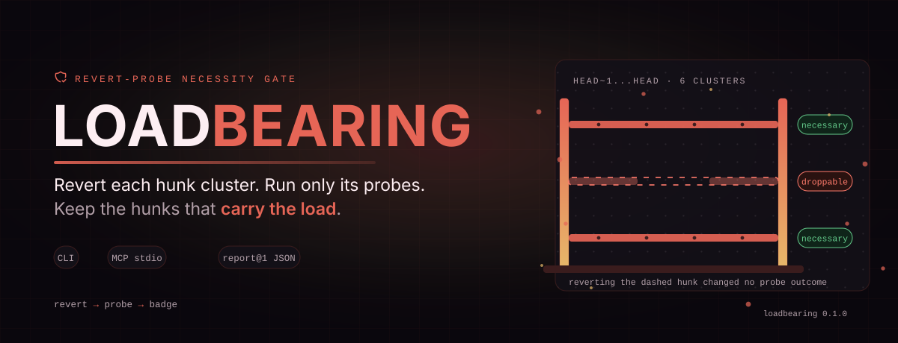
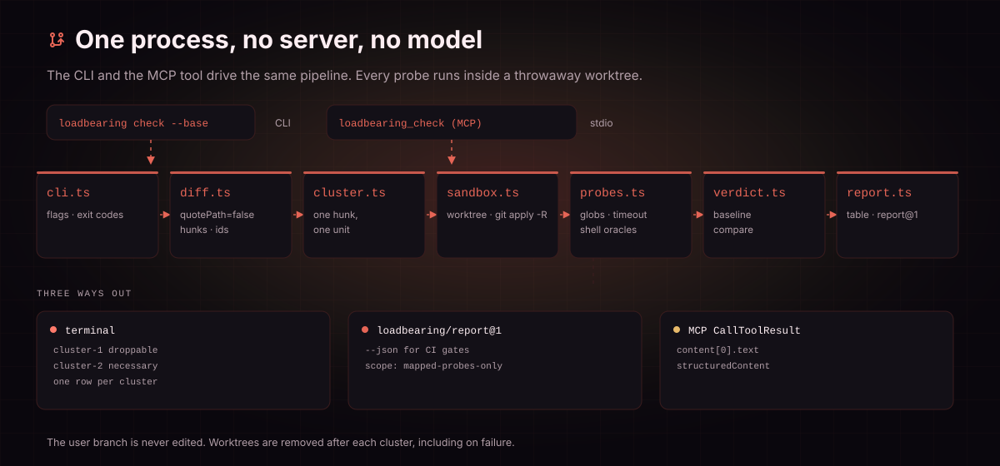
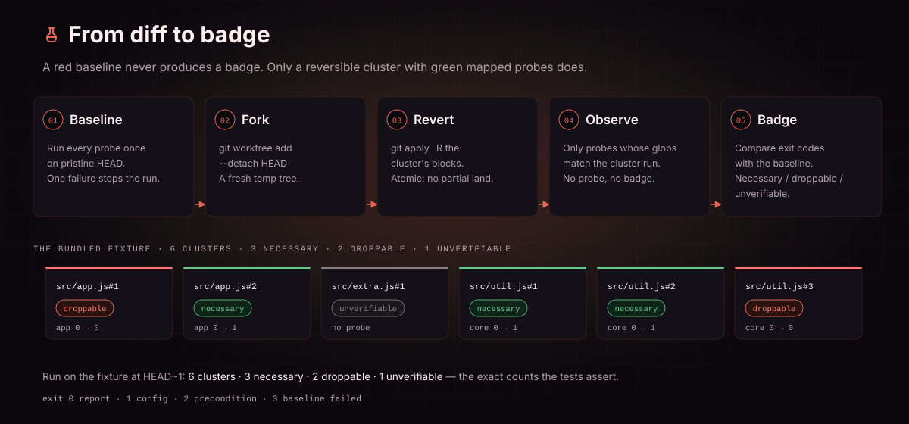
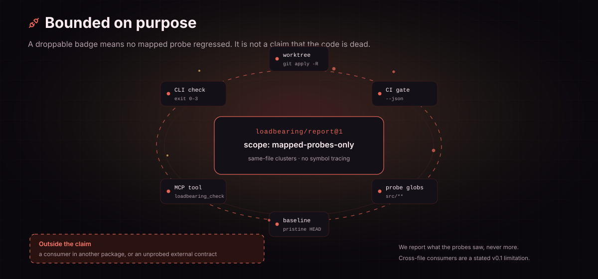

[English](./README.md) | **简体中文**

<p align="center">
  <picture>
    <source media="(max-width: 700px) and (prefers-color-scheme: dark)" srcset="./assets/hero-narrow-dark.svg">
    <source media="(max-width: 700px) and (prefers-color-scheme: light)" srcset="./assets/hero-narrow-light.svg">
    <source media="(prefers-color-scheme: dark)" srcset="./assets/hero-dark.svg">
    <source media="(prefers-color-scheme: light)" srcset="./assets/hero-light.svg">
    
  </picture>
</p>

<p align="center">
  <a href="https://github.com/SuperMarioYL/loadbearing/actions/workflows/ci.yml"></a>
  
  
  
  
</p>

<p align="center"><strong>把 hunk 还原回去，跑它的探针，只留下真正承重的代码。</strong></p>

Loadbearing 是一个免费、开源的「必要性闸门」，面向编码智能体提交的 Pull
Request。它把每个 hunk 集群放进一次性的 `git worktree` 里反向应用，只运行 glob
覆盖到该集群文件的探针，并给「还原后没有任何探针结果变化」的集群打上标记。审查者
不必逐行审计，而是开始处理判定：把可丢弃的集群退回给智能体，只读剩下的部分。

```console
$ loadbearing check --base HEAD~1
...
6 clusters: 3 necessary, 2 droppable, 1 unverifiable
```

没有模型、没有服务端、不改你的分支。一个 Node 进程，加上你已有的探针。

## 真正的问题是必要性，不是正确性

编码智能体提交一个 PR：三个文件、六个 hunk。你可以逐行审查正确性，批准其中大部分，
但仍然不知道哪些行是必需的。更贵的问题是：**如果这个 hunk 消失，会发生什么？**
对大多数 hunk 来说，没有人真的做过这个实验。

现有的手段都绕开了这个问题。提示词层面的「少写代码」技能在智能体动笔**之前**施加
影响，但偏好不是证明。补丁覆盖率只能说明某一行被执行过；一个冗余 hunk 只要被任何
测试碰到，覆盖率就是 100%，但它依然不必要。让 LLM 评论 diff，得到的只是观点，你还
得亲自验证，等于没有省下工作。变异测试同样扰动代码、观察探针，但它评分的是测试套件
对生成变异的充分性，不是眼前这个 PR 里的 hunk。

Loadbearing 直接问这个反事实问题，并用执行证据回答：移除集群，重跑它的探针，比较
退出码。

## 看它跑一次

仓库自带的 fixture 是一个刻意做成「智能体风格」的 PR：三个文件、六个 hunk，两个探针
只覆盖其中一部分文件。先安装打包好的 CLI（见[安装](#安装)），再对它运行：

```console
$ loadbearing check --base HEAD~1
base HEAD~1  head 1c87c62  6 clusters
scope mapped-probes-only: a verdict covers only the probes mapped to that cluster's files
baseline green (2 probes on HEAD)

cluster-1  droppable     probes-unaffected  src/app.js#1
    app   node test/app.js
      baseline 0 -> reverted 0
cluster-2  necessary     probe-failed       src/app.js#2
    app exited 1 while reverted
    app   node test/app.js
      baseline 0 -> reverted 1
cluster-3  unverifiable  no-probe           src/extra.js#1
    no probe matches src/extra.js
cluster-4  necessary     probe-failed       src/util.js#1
    core exited 1 while reverted
    core  node test/core.js
      baseline 0 -> reverted 1
cluster-5  necessary     probe-failed       src/util.js#2
    core exited 1 while reverted
    core  node test/core.js
      baseline 0 -> reverted 1
cluster-6  droppable     probes-unaffected  src/util.js#3
    core  node test/core.js
      baseline 0 -> reverted 0

6 clusters: 3 necessary, 2 droppable, 1 unverifiable
```

报告的 JSON 以这段结尾：

```json
"summary": { "total": 6, "necessary": 3, "droppable": 2, "unverifiable": 1 }
```

两行 `droppable` 才是重点。`src/app.js#1` 在整数求和外面套了一层 `Number()`，`src/util.js#3`
新增了一个没有任何映射探针会碰到的辅助函数；还原任何一个，探针结果都不变。`src/app.js#2` 锁定了
四舍五入，去掉它探针就会失败。第三个文件没有任何探针映射，所以它得到的是「无法判定」，
而不是猜测。

- 终端录像：[`docs/assets/demo.cast`](./docs/assets/demo.cast)（asciinema v2，
  15 秒）。用 `asciinema play docs/assets/demo.cast` 播放。
- 完整命令、捕获的 stdout 和完整报告：
  [`docs/demo-results.json`](./docs/demo-results.json)。
- 录制脚本：[`docs/record-demo.sh`](./docs/record-demo.sh)。
- 录像和上面的输出来自同一个打包好的 0.1.0 tarball 和同一份 fixture；
  `docs/demo-results.json` 保存了逐字节的 stdout。重新生成 fixture 时，唯一会变化的
  是输出里的短 `head` SHA。

## 判定是怎么做出来的

<p align="center">
  <picture>
    <source media="(prefers-color-scheme: dark)" srcset="./assets/architecture-dark.svg">
    <source media="(prefers-color-scheme: light)" srcset="./assets/architecture-light.svg">
    
  </picture>
</p>

规则有先后，顺序本身很重要：

1. **先跑基线。** 每个配置好的探针在干净的 `HEAD` 上跑一次。任何一个失败，进程以
   3 退出，有探针映射的集群一律变成 `unverifiable:baseline-failed`。基线是红的，
   就永远不会给出标记。
2. **一次一个集群。** 每个 hunk 起初都是独立集群。为它创建一次性的 detached
   worktree，只把该集群的 hunk 原文块用 `git apply -R` 反向应用。
3. **应用失败就合并。** 如果反向应用失败，就把同一文件里的下一个 hunk 并入当前集群
   重试。整个文件仍然失败，则是 `unverifiable:revert-apply-failed`。
4. **只跑映射的探针。** 探针的任一 glob 匹配集群的任一文件，就算映射。基线通过、
   还原后失败的探针，使集群成为 `necessary`；所有映射探针仍然通过，则是
   `droppable`。
5. **没有 oracle 就不打标记。** 没有匹配探针是 `unverifiable:no-probe`；超时、信号、
   进程启动失败或 `sandbox.setup` 失败是 `unverifiable:probe-error`。

<p align="center">
  <picture>
    <source media="(prefers-color-scheme: dark)" srcset="./assets/process-dark.svg">
    <source media="(prefers-color-scheme: light)" srcset="./assets/process-light.svg">
    
  </picture>
</p>

成本是「一次基线套件运行 + 每个被判定集群一次运行」。执行是串行的；`--timeout`
限制单个探针，`--max-clusters` 把剩余集群标成 `unverifiable:skipped`。用户分支永远
不会被修改，每个 worktree 都会被删除，失败时也一样。

## 安装

要求：Node 20 或更高、`git`、macOS 或 Linux。测试使用 Node 22。

0.1.0 的产物是 GitHub Release 上的 tarball（`loadbearing-gate-0.1.0.tgz`）。
直接安装它，或者从源码构建：

```console
# 用 release tarball
curl -LO https://github.com/SuperMarioYL/loadbearing/releases/download/v0.1.0/loadbearing-gate-0.1.0.tgz
npm install -g ./loadbearing-gate-0.1.0.tgz
loadbearing --version

# 或者克隆、构建并链接可执行文件
git clone https://github.com/SuperMarioYL/loadbearing.git
cd loadbearing
npm ci
npm run build
npm link
loadbearing --version
```

包名是 `loadbearing-gate`，可执行文件名是 `loadbearing`。短包名已被另一个无关项目
占用，所以包名做了区分，避免运行成别的工具。这个包还没有发布到 npm registry；
发布之后 `npm install -g loadbearing-gate@0.1.0` 才可用（见路线图）。

## 快速开始

### 跑自带 fixture（不需要配置）

下面这些命令从克隆仓库开始，用的正是发布工作流上传的那个 tarball：

```console
git clone https://github.com/SuperMarioYL/loadbearing.git
cd loadbearing
npm ci
npm run build
npm pack
bash fixtures/seed-agent-pr.sh /tmp/lb-demo
cd /tmp/lb-demo
npx --yes "file:$OLDPWD/loadbearing-gate-0.1.0.tgz" check --base HEAD~1
```

你应该看到 `6 clusters: 3 necessary, 2 droppable, 1 unverifiable`。fixture 自带的
`loadbearing.yml` 把 `test/core.js` 映射到 `src/util.js`，把 `test/app.js` 映射到
`src/app.js`；没有任何探针映射到 `src/extra.js`。

### 接到自己的仓库

项目需要有一个 `package.json`，其中至少有 `test`、`typecheck` 或 `lint` 之一，
还需要一个可以比较的分支。

```console
cd your-project
loadbearing init
```

`init` 会为找到的每个脚本写一个探针，并给**每个**探针都加上较宽的默认 glob
（`src/**`、`lib/**`、`test/**`、`tests/**`）。下面是 `init` 在带有 `test`、
`typecheck`、`lint` 脚本的 `package.json` 上实际写出的文件：

```yaml
# Loadbearing probes: each command is an oracle for the file globs below.
# A cluster is droppable only when every probe mapped to its files still passes.
schema: loadbearing/config@1
probes:
  - name: test
    run: npm test
    paths:
      - src/**
      - lib/**
      - test/**
      - tests/**
  - name: typecheck
    run: npm run typecheck
    paths:
      - src/**
      - lib/**
      - test/**
      - tests/**
  - name: lint
    run: npm run lint
    paths:
      - src/**
      - lib/**
      - test/**
      - tests/**

# Run once per sandbox worktree before probes (uncomment when you have a lockfile):
# sandbox:
#   setup: npm ci
```

把 `paths` 收紧到每个探针真正能观察到破坏的范围，然后对分支起点运行：

```console
loadbearing check --base origin/main
```

先提交或 stash 本地改动：工作区不干净时 `check` 会以 2 退出，因为只有 `HEAD` 与实际
文件一致时，还原出来的判定才有意义。

## 用法

```
loadbearing init
loadbearing diff  --base <rev> [--json]
loadbearing check --base <rev> [--json] [--config <path>] [--timeout <seconds>]
                  [--max-clusters <n>] [--keep-worktrees]
loadbearing mcp
loadbearing --version
```

| 命令 | 作用 |
| --- | --- |
| `init` | 根据 `package.json` 脚本写出初始 `loadbearing.yml`；已存在时拒绝覆盖。 |
| `diff` | 列出 `<base>...HEAD` 的 `file#n` hunk id 和单 hunk 集群。`--json` 输出 `{base, files, clusters}`；无法判定的区段带 `unsupported` 标记。这是清单，不是判定报告。 |
| `check` | 跑基线、逐个还原集群、运行映射探针，打印判定表或 `loadbearing/report@1` JSON。 |
| `mcp` | 通过 MCP stdio 提供 `loadbearing_check`。stdout 只承载协议帧。 |

`check` 退出码：

| 退出码 | 含义 |
| --- | --- |
| `0` | 已输出报告。判定仍可能是「无法判定」。 |
| `1` | 配置或参数错误。 |
| `2` | 前置条件失败：base 不存在、没有共同历史、不是 git 仓库，或工作区不干净。 |
| `3` | 基线失败。报告仍会输出。 |

反向应用失败、想检查沙箱时用 `--keep-worktrees`，保留路径会打印到 stderr。

## 让编码智能体调用

`loadbearing mcp` 暴露一个工具 `loadbearing_check`，输入是
`{base, config?, timeout?}`，返回 `CallToolResult`：报告 JSON 在
`content[0].text`，同一个对象也在 `structuredContent`。base 不合法时返回
`isError: true`，服务端不会崩溃。

Claude Code（需要先安装 CLI，见[安装](#安装)）：

```console
claude mcp add loadbearing -- loadbearing mcp
```

Cursor（`~/.cursor/mcp.json` 或 `.cursor/mcp.json`）：

```json
{
  "mcpServers": {
    "loadbearing": {
      "command": "loadbearing",
      "args": ["mcp"]
    }
  }
}
```

让智能体在请求 review 之前调用 `loadbearing_check`，参数
`{"base": "origin/main"}`。智能体拿到的判定和人类看到的一样；它可以自行删掉可丢弃的
hunk，也可以留给审查者处理。

## 配置

从仓库根目录读取 `loadbearing.yml`（或 `loadbearing.yaml`）。`--config <path>`
覆盖位置，路径相对仓库根目录解析。

```yaml
schema: loadbearing/config@1

probes:
  - name: test
    run: npm test
    paths:
      - src/**
      - lib/**
      - test/**
      - tests/**

  - name: typecheck
    run: npm run typecheck
    paths:
      - src/**
      - lib/**

# 每个沙箱 worktree 在探针之前执行一次。worktree 没有自己的 node_modules 时需要，
# 例如使用 npm ci 或 monorepo 的场景。
sandbox:
  setup: npm ci

# 单探针超时，单位秒。默认 120。
timeout: 120
```

| 键 | 类型 | 必填 | 说明 |
| --- | --- | --- | --- |
| `schema` | string | 否 | 只接受 `loadbearing/config@1`。 |
| `probes[].name` | string | 是 | 唯一，用于配对基线和还原后的运行。 |
| `probes[].run` | string | 是 | shell 命令。typecheck 也只是另一个探针。 |
| `probes[].paths` | string[] | 是 | picomatch glob，匹配规范化后的 diff 路径，至少一个。 |
| `sandbox.setup` | string | 否 | 每个 worktree 在探针前执行一次；失败时集群为 `unverifiable:probe-error`。 |
| `timeout` | integer | 否 | 单探针超时秒数，可被 `--timeout` 覆盖。 |

glob 太宽会让探针多跑、变慢且更保守；glob 太窄会产生 `no-probe`，闸门宁可拒绝打
标记也不猜。`probes[].paths` 是声明探针与文件映射的唯一位置。

## 报告

`check --json` 和 MCP 工具输出同一份 `loadbearing/report@1`：基线状态、每个集群的
条目（带基线与还原后的退出码）、失败探针最后 20 行输出，以及汇总。逐字段说明见
[`docs/report-schema.md`](./docs/report-schema.md)。

```json
{
  "schema": "loadbearing/report@1",
  "scope": "mapped-probes-only",
  "baseline": { "ok": true, "probes": [] },
  "clusters": [
    {
      "id": "cluster-2",
      "hunkIds": ["src/app.js#2"],
      "files": ["src/app.js"],
      "verdict": "necessary",
      "reason": "probe-failed",
      "detail": "app exited 1 while reverted",
      "probes": [
        { "name": "app", "run": "node test/app.js", "baselineExitCode": 0, "revertedExitCode": 1 }
      ]
    }
  ],
  "summary": { "total": 6, "necessary": 3, "droppable": 2, "unverifiable": 1 }
}
```

把它接进 CI，在 `summary.droppable > 0` 时失败；或者存成 artifact 供 review 使用。
没有托管看板，也没有 GitHub App；JSON 就是集成面。

## 边界：标记意味着什么，不意味着什么

<p align="center">
  <picture>
    <source media="(prefers-color-scheme: dark)" srcset="./assets/scope-dark.svg">
    <source media="(prefers-color-scheme: light)" srcset="./assets/scope-light.svg">
    
  </picture>
</p>

**`droppable` 只意味着：映射到这个集群文件的探针没有一个回退。它不意味着代码是死的。**
如果某个 hunk 的唯一使用者在没有探针映射的文件里——另一个包里的调用方、配置、外部
契约——这个集群仍可能被判为可丢弃，但删掉它照样会破坏那个使用者。报告里固定写着
`scope: mapped-probes-only`，原因就在这里。

0.1 的其他限制，明说而不是糊过去：

- **只在文件内合并。** 单个 hunk 无法反向应用时，会并入同文件的下一个 hunk。不跨文件
  聚类，也从不追踪符号引用。
- **不自动修复。** Loadbearing 只报告；不删 hunk、不推提交、不改分支。
- **不支持的 diff。** 二进制文件、纯重命名、仅权限变更和子模块指针变更都会返回
  `unverifiable:unsupported-diff`，而不是被丢弃；merge commit 会为整个 diff 生成一个
  `unverifiable:unsupported-diff` 标记。无法判定的 PR 永远不会被当成干净的。
- **每种状态只跑一次。** 没有重试、重复运行或 flaky 检测。探针不稳定，判定就不稳定。
- **串行且有上限。** 成本是 `集群数 + 1` 次套件运行。`--timeout` 和 `--max-clusters`
  限制工作量，剩下的标为无法判定。
- **没有探针就没有信号。** 仓库没有能映射到文件的探针时，得到的是 `no-probe`，不是
  意见。此时闸门退化成 diff 查看器，并且会说明这一点。
- **平台。** 支持 macOS 和 Linux；0.1 不支持 Windows worktree。

## 与其他手段的区别

| 手段 | 回答的问题 | 留给你的事 |
| --- | --- | --- |
| 提示词层面的「少写」技能 | 「在 diff 出现之前少写点。」 | 只是偏好，不是逐 hunk 判定。 |
| 补丁覆盖率 | 「这一行执行了吗？」 | 冗余 hunk 也可能 100% 覆盖。 |
| LLM 评论 diff | 「这看起来不必要吧？」 | 亲自验证这个观点。 |
| 变异测试 | 「测试套件对变异够不够强？」 | 把变异分数映射回这个 PR 的 hunk。 |
| **Loadbearing** | 「还原这个集群，映射探针会变吗？」 | 理解上面的 `mapped-probes-only`。 |

它们做的是不同的事。「少写」技能减少智能体写出来的东西；闸门审计真正落地的内容。
覆盖率报告执行过；闸门报告反事实。变异测试问套件强不强；闸门问这个 diff 是否必要，
把套件当作它本来就该是的 oracle。

## 路线图

候选工作，0.1 尚未实现：

- 跨文件聚类：处理那些必须一起应用或一起编译才成立的 hunk，并在报告里明确边界。
- 有界 worker 池的并行集群执行，以及按「集群补丁 + 探针命令」缓存结果。
- Jest、pytest、`go test` 的探针适配器，同时保留显式 glob 作为唯一事实来源。
- 重命名和二进制支持，不再只是报告为无法判定。
- 把 `loadbearing-gate` 发布到 npm registry；0.1.0 目前以 GitHub Release tarball 形式发布。
- Windows worktree 支持。

原语不变：还原，跑映射探针，报告反事实。

## 开发

```console
npm ci
npm run typecheck
npm run build
npm test -- --run
```

测试会用 `fixtures/seed-agent-pr.sh` 生成临时 git 仓库，因此需要 `git` 和可写的临时
目录。MCP 测试会启动构建后的 stdio 服务，调用 `loadbearing_check`，并把判定与
`check --json` 比较。

<p align="center"><sub><a href="./LICENSE">MIT</a> © 2026 SuperMarioYL</sub></p>
